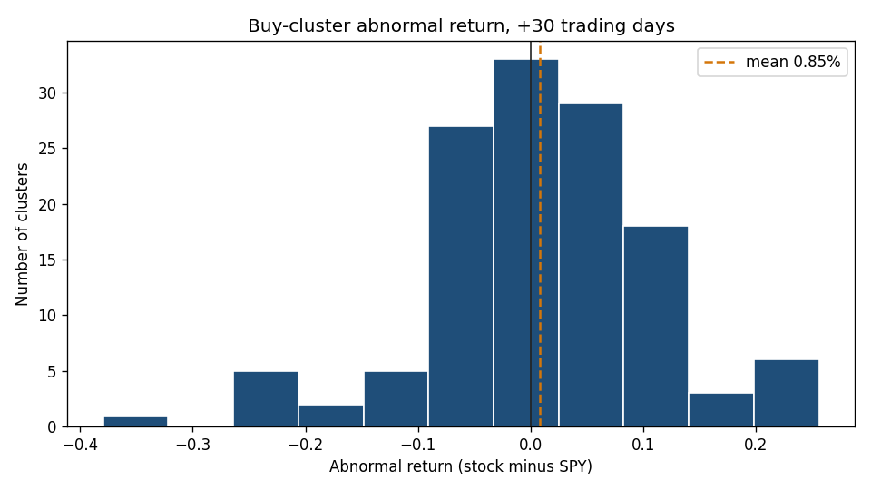
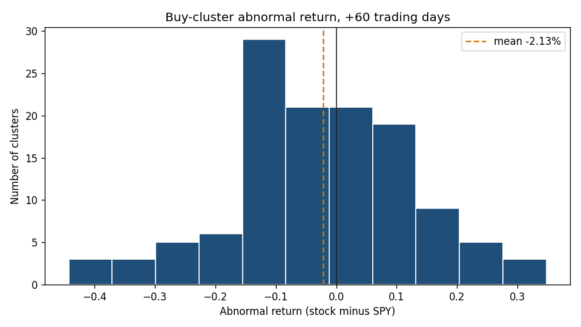
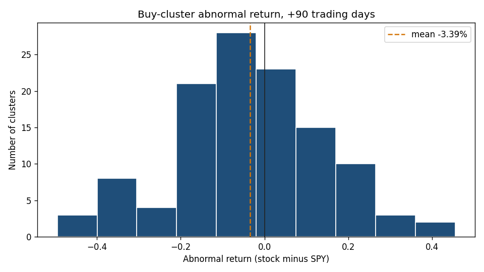
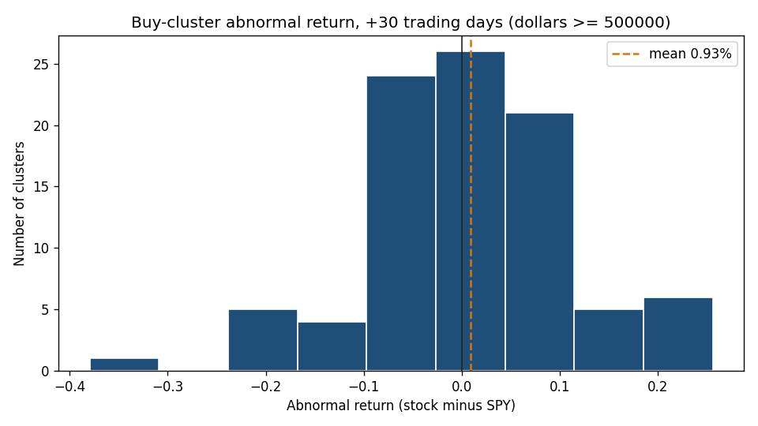
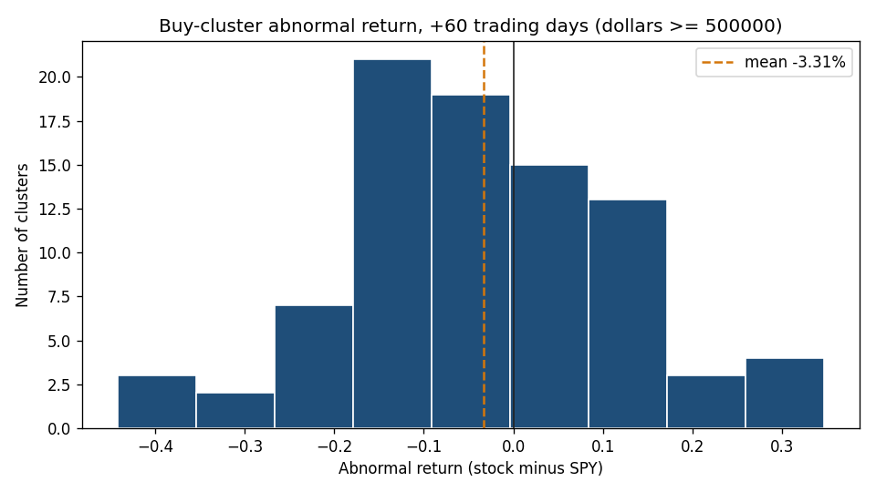
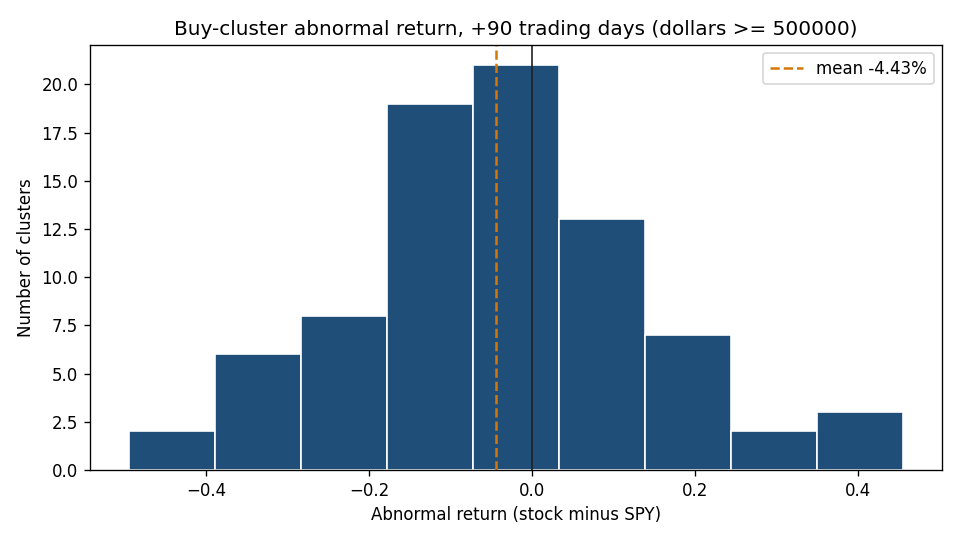

# Insider buy-cluster event study

## Research question

Do insider buy-clusters (at least two distinct insiders buying the same stock inside a short window) show abnormal returns versus SPY at 30, 60, and 90 trading days?

## Framing

This is an event-study methodology demonstration on a clean row-level insider-transaction dataset — not a trading signal. Known literature finds clustered insider purchases carry modest short-horizon signal; sales carry almost none. Expected and acceptable outcome: weak effects with wide error bars.

## Cluster definition and filters

Universe: companies with `passesLayer1 = true` in the InvestaBot `Company` table.

Purchases: SEC Form 4 rows in `InsiderTransaction` with transaction code `P`. The ticker is the `ticker` column on that table, limited to the layer-1 universe.

A qualifying window is a span of 14 calendar days, used as a stand-in for 10 trading days, that contains purchases by at least two distinct `insiderName` values. Distinct insiders are counted by name. Overlapping qualifying windows on the same ticker are merged into one cluster, and a purchase row is counted once. A purchase that never sits inside a qualifying window is not pulled into a neighboring cluster.

The cluster event date is the last purchase date in the merged cluster. `first_buy_date` is the first.

Dollar size is the sum of `shares * pricePerShare` across the cluster. Rows with a null price stay in the cluster (they still count as a buy and as an insider) but add nothing to the total. The default export keeps clusters whose total is at least $100,000 (`--min-dollars`). That floor is there because some names show recurring small plan purchases that would otherwise look like clusters. The analysis also repeats every statistic on the subset with `total_dollars >= 500000`. Newly listed securities (e.g. recent spin-offs) are excluded because post-listing drift is a distinct phenomenon and pre-event history is required to define abnormal return.

## Abnormal return

For each cluster and each horizon N in {30, 60, 90}:

- Day 0 is the event date if that date is a trading session, otherwise the next session.
- Stock return is the adjusted close on day 0+N divided by the adjusted close on day 0, minus one.
- SPY return uses the SPY adjusted closes on those same two dates.
- Abnormal return is the stock return minus the SPY return.

Reported for each horizon, on the full sample and on the $500,000 subset: mean, median, hit rate (percent of abnormal returns that are positive), standard error of the mean (sample standard deviation divided by sqrt(N)), a t-statistic (mean divided by that standard error), N, and the count of clusters skipped for missing prices or an incomplete forward window.

## Results

Across 139 insider buy-clusters in S&P 500 names (Sept 2024–Sept 2026; 7 excluded for insufficient pre-event price history), clusters show no significant 30-day abnormal return (+0.9%, t=0.96) and a negative drift at longer horizons: −2.1% at 60 trading days and −3.4% at 90 (t=−1.55 and −2.03), with the pattern stronger in clusters totaling ≥$500k (−4.4% at 90 days, t=−2.14, hit rate 38%). The result is robust to removing mega-row corporate-transaction events and to the pre-history exclusion. It should not be read as insiders trading against their own information: the likeliest account is dip-buying into declines that continued, within a single market regime, with ~130 partially overlapping events whose t-statistics overstate independence. The notable observation is that the classic modest positive post-cluster drift reported in older literature did not replicate here.

| subset | horizon_trading_days | n | skipped | excluded_insufficient_history | mean_abnormal_return | median_abnormal_return | hit_rate_pct | std_error | t_stat |
| --- | --- | --- | --- | --- | --- | --- | --- | --- | --- |
| all | 30 | 129 | 3 | 7 | 0.008515 | 0.007201 | 55.0388 | 0.008853 | 0.9618 |
| all | 60 | 124 | 8 | 7 | -0.021262 | -0.025134 | 44.3548 | 0.013740 | -1.5474 |
| all | 90 | 117 | 15 | 7 | -0.033870 | -0.033631 | 41.0256 | 0.016659 | -2.0331 |
| dollars_gte_500000 | 30 | 92 | 2 | 4 | 0.009292 | 0.009925 | 54.3478 | 0.011477 | 0.8097 |
| dollars_gte_500000 | 60 | 87 | 7 | 4 | -0.033144 | -0.032072 | 40.2299 | 0.016958 | -1.9545 |
| dollars_gte_500000 | 90 | 81 | 13 | 4 | -0.044303 | -0.058377 | 38.2716 | 0.020692 | -2.1411 |
| ex_mega | 30 | 127 | 3 | 6 | 0.008701 | 0.007201 | 55.1181 | 0.008951 | 0.9721 |
| ex_mega | 60 | 122 | 8 | 6 | -0.021834 | -0.025134 | 44.2623 | 0.013950 | -1.5651 |
| ex_mega | 90 | 115 | 15 | 6 | -0.036029 | -0.041347 | 40.8696 | 0.016838 | -2.1398 |



Full sample, abnormal return at 30 trading days.



Full sample, abnormal return at 60 trading days.



Full sample, abnormal return at 90 trading days.



Clusters with total dollars at least $500,000, abnormal return at 30 trading days.



Clusters with total dollars at least $500,000, abnormal return at 60 trading days.



Clusters with total dollars at least $500,000, abnormal return at 90 trading days.

## Data provenance

Insider transactions are SEC EDGAR Form 4 filings, parsed by Investabot into row-level `InsiderTransaction` records. The cluster file `data/clusters.csv` is produced by `scripts/diagnostics/exportBuyClusters.js` in the InvestaBot repo (read-only). Copy that file to `data/clusters.csv` when this directory is published on its own.

Prices are adjusted daily closes fetched at run time via yfinance. They are written only under `data/prices/`, which is gitignored. Yahoo Finance data is not redistributed and must not be committed or copied into the public repository.

## How to run

From the InvestaBot repository root, then from this directory:

```
node scripts/diagnostics/exportBuyClusters.js
python fetch_prices.py
python analyze.py
```

Install dependencies once before the Python commands: `pip install -r requirements.txt`.

The exporter prints the database host and refuses to start unless `DATABASE_URL` is set. It only reads. Optional flags: `--min-dollars <n>` (default 100000) and `--fixture` (clustering self-test, no database).

Outputs: `results/summary.csv`, plus `results/hist_30.png`, `results/hist_60.png`, and `results/hist_90.png` (and the same charts with a `_ge500k` suffix for the robustness subset, when that subset has returns).

## Limitations

- No survivorship handling. Names that later delist or change ticker drop out when Yahoo has no usable price history, which biases the sample toward names that still resolve.
- Unofficial price source. Adjusted closes come from Yahoo Finance through yfinance, not from a licensed research vendor, and they are not redistributed with this study.
- 139 clusters were found, and 7 are excluded for insufficient pre-event history. Per-horizon N is 129, 124, and 117 at 30, 60, and 90 trading days in the full sample; 92, 87, and 81 in the $500,000 subset; and 127, 122, and 115 in ex_mega, so standard errors are wide.
- Event windows overlap across clusters within the same market regime, so t-statistics overstate independence.
- No transaction costs, borrow, or slippage. The figures are close-to-close abnormal returns, not a tradable backtest.
